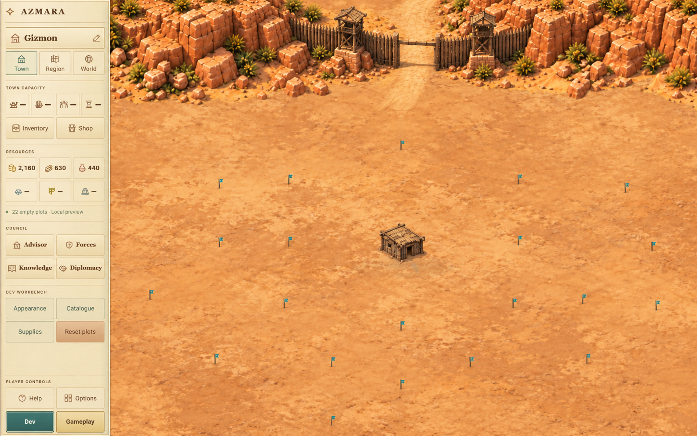
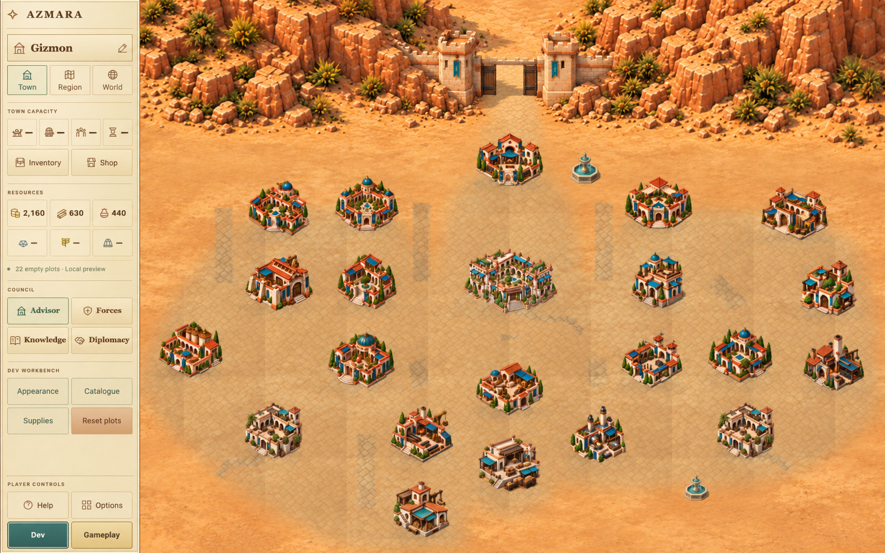
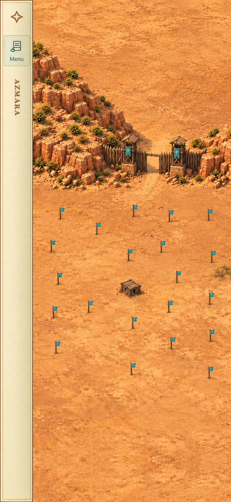
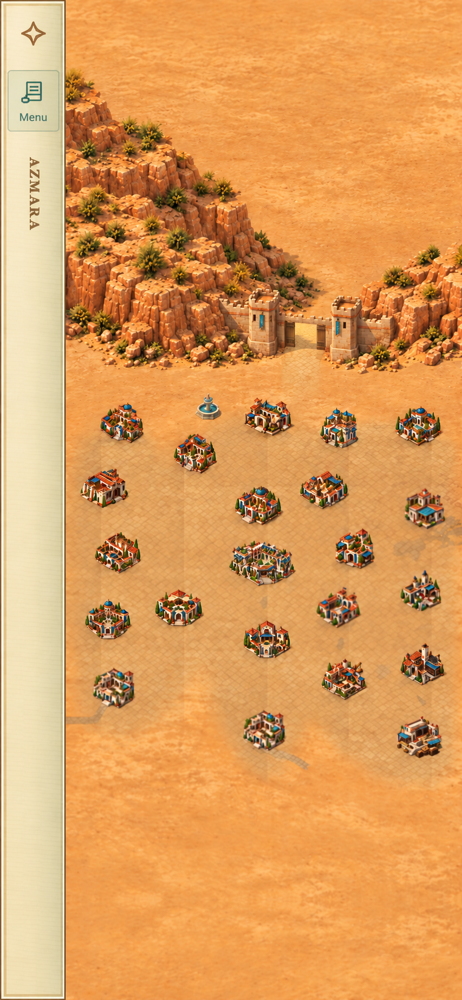

# Canyon and wall defence proposal

13 October 2026. Proposal only under DEC-087; no new canyon or wall art is
installed in the game. Keep the current rear wall, all plots and five layouts.

Recommend the existing rear-pass composition, with a stronger asymmetric left
cliff shoulder and one rock-embedded gate at the narrowest pass. Use the proposed
80% building scale as the visual reference, not as an approved default.
The wall should read as part of the canyon rather than a separate facade.

## Desktop concepts

Starting town, with a hypothetical **built timber Level 1 wall** for material
review. The real starting save still has an unbuilt wall and an open pass.
The source is the actual desktop 80% Appearance screenshot.

Ideal Level 50. The source is the explicitly labelled offline desktop 80%
placement render, using the captured camera and plot positions; this paint-over
is not a browser screenshot.

## Phone concepts

Starting town with the same hypothetical built timber wall. The narrow rail
remains separate from the game area. Source: actual phone 80% start capture.

Ideal Level 50, from the actual phone 80% Appearance capture.

These are generative paint-overs, not exact asset registration. The existing
buildings and pins are reused as references, but minor generated changes to
their pixels, flags or UI text must not be imported into runtime. The early
phone image embellishes the stakes; the actual test pins remain small, plain
teal banners. Transient Appearance headers were removed in the proposal images,
not by editing the screenshots used as evidence.

## Recommended defence composition

The left bank comes from the edge of the game area and joins the northern ridge.
Its shape is deliberately different from the right bank. Both banks end at
rocky shoulders beside the gate, above the nearest plots. The front and lower
sides remain open: no enclosing ring, no extra wall role and no new plots.

There are exactly two towers. Their feet sit on outcrops, with short stepped
foundations, rubble and contact shadows. Curtain ends disappear into the rock.
The gate opens onto the main approach into town. Tops and side faces use the
same elevated oblique view as the buildings; upper-left sunlight casts short,
soft lower-right shadows. The desktop and phone concepts improve grounding,
but the central curtain is still fairly frontal. Final art must have a stronger
diagonal ground plane rather than copying this facade unchanged.

Keep the existing gate centres: desktop world `(2100,400)`, compact world
`(3150,1620)`. Do not move wall-01 or other fixed-role anchors. No Fit change is
proposed by these concepts. Before implementation, measure complete cliff,
foundation and shadow bounds against every layout and phone Fit/MAX; if they
require a new camera envelope or plot position, return for approval first.
The generated shoulder positions are not proof of those clearances.

## Wall materials and levels

Keep the current completed-wall ranges and all uneven upgrade milestones.
Hall level must not build or upgrade the wall.

| Completed wall | Material treatment | Shared specification |
| --- | --- | --- |
| 1–10 | Rough timber posts, braces and humble watchtowers on low footings | One short route, two tower centres, one opening |
| 11–32 | Earthen adobe over the same foundation, thicker piers and parapets | Same footprint, gate width and tower count |
| 33–50 | Dressed sandstone, refined caps and stronger foundations | Same footprint, gate width and tower count |

Adobe is specified here, not shown as a new final asset. Timber and sandstone
paint-overs express the shared composition approximately; they are not three
pixel-identical production variants. A future approved atlas should register
all three materials to one measured footprint, gate threshold and tower centres.
No material should add towers, enlarge the settlement reserve or move targets.

## Existing defects and scenery

| Item | Effect of this proposal |
| --- | --- |
| Repeated or extra ring towers | The ring is already inactive. Keep two towers; retain old art for rollback. |
| Gate target alignment | Still requires actual input verification and registration to any newly approved art. A paint-over does not fix it. |
| Phone Fit and scale | Still requires real phone/compact checks. No new Fit or camera rule is implemented. |
| Detached ends and foundations | Addressed visually in the concepts, not fixed in runtime. |
| Mixed facade and building angle | Improved top/side detail, but still a final-art requirement. |
| Five layouts and fixed roles | Unchanged. Validate the same northern reserve for all five before integration. |
| Oasis ground and streets | Preserve public courts and existing sockets. Only the gate approach should join the defence; do not resume Levels 24/26. |

No rivers, sea, ships or naval roles are reintroduced. Existing closed decorative
fountains can stay. The cliff band must not swallow the playable town or make
the buildings smaller to compensate.

## Changes required only if approved later

Replace the rear cliff and three-material wall artwork, then remeasure the
existing crop, doorway, tower, shadow and exclusion metadata. Likely runtime
files are `prototype/town-wall.js`, its asset registration in `prototype/app.js`
and the valley-specific ground mask in `prototype/oasis-town.js`; this round
changes none of that wall/cliff integration. Any extra camera/layout work needs
an explicit scope decision before implementation.

Risks are incorrect art anchors, cliff overlap, cropped phone towers, a gate
road that misses the doorway, and a sharper wall than its surroundings.
Keep the current atlas, cliff image, registration and all historical evidence
for rollback. This proposal adds only five PNGs and its provenance file under
`docs/ideas/canyon-defences-study/`; none belongs in a deployment.

## Image provenance and review limits

Built-in ImageGen only; all inputs are original AZMARA renders, captures or
new AZMARA concepts. No Ikariam image was used as an input. Each desktop and
starting-phone image used one attempt. Phone Level 50 used two: the first
closed gate was corrected to show the approach through an open passage.
No third attempt was made.

Exact prompts, source paths and selected filenames:
[Art provenance](canyon-defences-study/ART_PROVENANCE.json).
The rejected phone Level 50 first attempt is retained next to the selected one.

Stop here for Owner approval. No wall replacement, default 80% scale, broader
Oasis rollout, native update or publication follows automatically.
