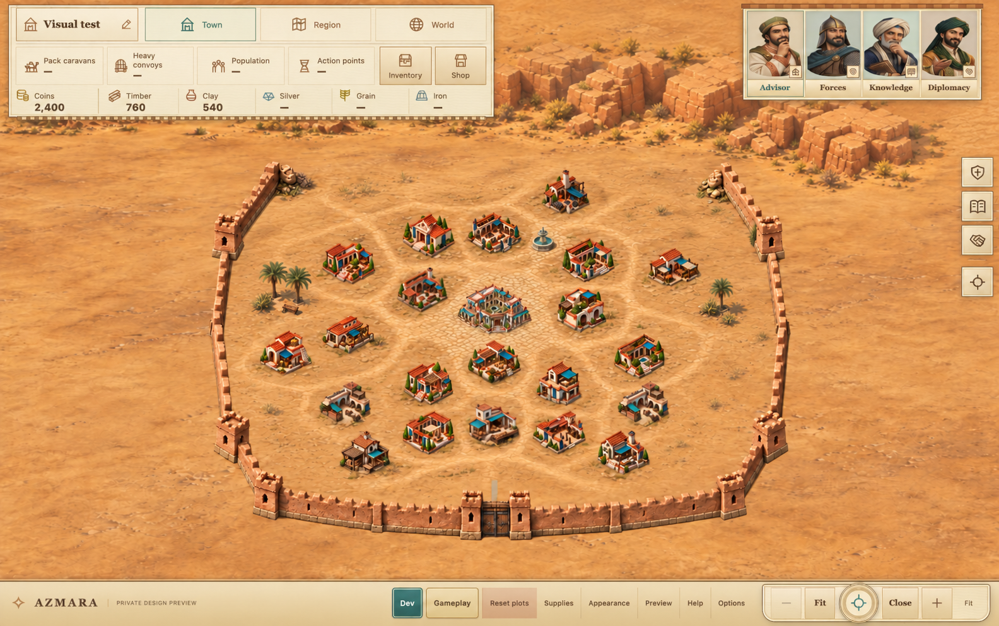
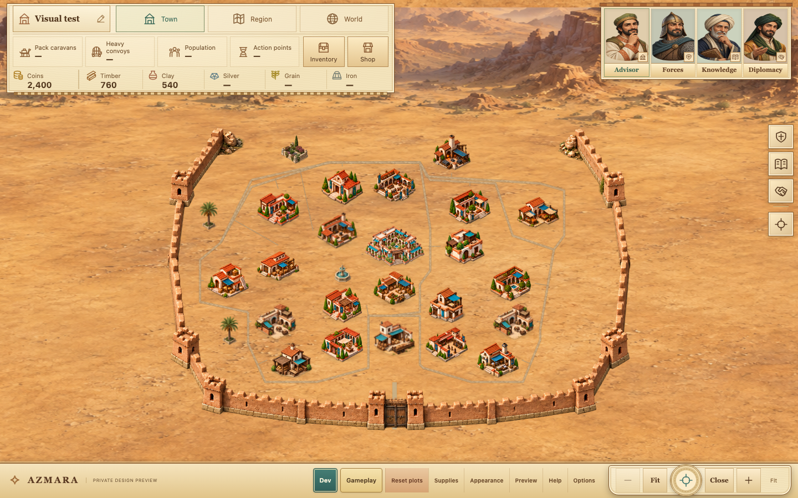

# Oasis Town — Level25 middle-stage draft

12 October 2026 (Europe/London) · DEC-077 · **Proposal only, not implemented**

- A maintained trading town, not bare camp ground and not the finished metropolis.
- Packed-earth lanes, selective civic paving, two modest shade pockets and one
  closed fountain. No road circuit or continuous marble carpet.
- Same desktop/Staggered layout and existing per-type building art. Wall work,
  phone/layout rollout, motion, native updates and publication remain paused.

## Mock-up

Built-in ImageGen paint-over of **AZMARA's own current Level25 capture**; the
accepted AZMARA Level50 Fit capture supplied material/direction reference only.
No other-game images were inputs. The output approximates the existing building
art rather than reproducing its pixels exactly; it is not a new game asset.
Two attempts were used. The first over-decorated the town and added a second
fountain; the final revision simplifies the scenery and rear rocks.

**Remaining discrepancy:** the generated palms are still farther out than the
intended reserved gaps and are not accurately registered/scaled to them. Use
the image to review middle-stage ground/material/density, **not** approve those
literal positions. The placement limits below govern any later implementation.
HUD, buildings and wall are generatively approximated; no alteration to those
is proposed by this drawing. Final output1584×993 is not exact1440×900 source
framing/pixels. No third art attempt or local pixel editing.

## What Level25 should communicate

| Founding1 — accepted | Middle25 — proposed | Mature50 — accepted |
| --- | --- | --- |
| Bare dusty field, wooden Hall, one sparse young-palm refuge | Maintained earth; modest stone civic court; short worn lanes and loading aprons; dry/medium shade groups | Broader integrated public paving, developed shade courts and two fountains |

These are visual targets, not economic/population rules or approval of a
universal upgrade cadence. Completed25 is a representative midpoint, not a
new approved threshold for all levels2–49.

Middle-stage treatment:

1. **Ground:** use the accepted quiet, same-angle rear terrain/material family.
   Wear and maintained soil should join buildings into neighbourhoods without
   making the whole interior cream marble. Preserve dusty workshop/trade yards
   and open gaps. Small worn stone areas centre civic activity around the Hall.
2. **Streets:** shallow tactile earth/patchy buff setts between destinations,
   not thin outline lines, raised flat ribbons or a perimeter circuit. No broad
   road through the tight Hall/Depot frontage. Where useful, small lateral
   landings connect into shared floor, rather than cutting through another plot.
3. **Shade:** one compact western developing community pocket and one smaller
   eastern refuge. Low dry planting and restrained timber seating; no formal
   lawn, stone planter podium, extra market building or palms scattered on every
   plot. Replace the older scattered props deliberately, not layer over them.
4. **Water:** one modest enclosed northern fountain. No river, rill, channel,
   functional water infrastructure or other navigable water.
5. **Depth:** the same elevated orthographic/dimetric2.5D view and upper-left sun.
   Warm lower-right baked shadows have one owner. Preserve existing buildings'
   body/contact/shadow, without adding another dark halo. No new engine/camera.

## Actual source and limits

**Observed, AZMARA:** current Level25 is outside the endpoint pilot gate and
uses the prior scenery: thin circuit-like streets, scattered palms/planters
and the older distant canyon backdrop. The isolated1440×900 capture contains
23 occupied role IDs,27 decoded images, zero captured errors and closed owned
browser/server. It is synthetic ideal progress, not Owner progress.

**Inferred:** the abrupt fallback makes the middle town feel less cohesive than
the accepted endpoints. **Proposed:** the maintained-ground direction above.

Logical completed level and source-art label differ under the current uneven,
deterministic per-type schedules. At25:

| Role | Actual displayed source |
| --- | --- |
| Town Hall | Hall art25; completed milestone22 |
| Warehouse | art25; crop307,544,313,220 |
| Both Caravan Stations | art25; crop316,485,307,268 |
| Freight Depot | art25; crop317,488,306,263 |
| Academy, Provision House, Palace, Governor's Residence, Trading Post, Route Archive, Forester, Silver Refinery | art20 |
| Field wall | Existing adobe band11–32, unchanged |

Do not homogenize every building into art25 or transplant the grand Level50
silhouettes. Reuse the original source-stage mapping. Hall1/50, Warehouse50 and
Caravan50 entrance UVs are **not verified25 thresholds**. Freight remains
unresolved. Do not copy an endpoint port merely because the building name matches.

## Tentative world-space limits

Existing approved mature maxima provide conservative planning envelopes:

| Pocket | Center x,y, world units | Maximum full crown/body/contact/shadow |
| --- | --- | --- |
| West | 1580,1297 | 288×184 |
| East | 2910,1156 | 220×192 |

Smaller developing motifs must fit wholly inside these, with24-WU clearance
from full protected plot/HUD/wall envelopes. Prior Level50 evidence had26/25-WU
nearest gaps; **Level25 clearance is not independently measured here**. The
current capture receipt does not provide fitted world body/CTM measurements.
Those old gaps cannot establish acceptance of a new25 placement or generated
pixel position. Measure actual25 Fit/Close bodies before implementation; if
unsafe, omit the pocket with a reason rather than move a plot or shrink a target.

The previously measured Hall/Depot gap was only18.563WU. It is a warning against
a new front boulevard, not certified25 route geometry. Hall25 needs a checked
visible threshold and shallow lateral landing; both Caravan routes need their
own complete-width checks. No collision/pathfinding/navigation claim.

## Bounded implementation proposal — requires separate OK

Only add **completed/review25, desktop/Staggered** to the local pilot initially.
Keep0/1/50 unchanged, and keep all other levels/layouts/compact frames on their
existing renderer. No five-layout/all-band rollout hidden inside this step.
Mixed buildings must retain `min(Hall, actual completed building)` local
quality; queued target levels and temporary review must not alter actual saves.

Future files: `prototype/oasis-town.js` for the middle-band floor/props and
selected newly checked source sockets; `prototype/index.html` for cache only;
one original two-motif middle-shade atlas/brief if the proposed compound art is
commissioned; new evidence/docs. The existing `app.js` source-art metadata
already supplies visible review art and should not need another state/queue
change. Reuse accepted ground/street/fountain sources rather than regenerate
all ground plates. The current concept PNG must **never** become the runtime
background: it bakes buildings, UI and approximated wall into one picture.

Expected effort is one bounded middle-state art/integration/verification pass,
not the full level/layout matrix. New shade art would have a two-attempt cap,
complete crop ownership and a≤1536²/9MiB source-pixel ceiling. No phone memory
claim; this draft adds zero runtime images. No new libraries/plugins/tools,
file moves or engine/native change.

Risks: abrupt level24/25/26 fallback, over-mature paving, crop/fringe artifacts,
wrong source sockets, overlapping crown/shadow/paint and extra cached image
memory. The first risk stays explicit: a single-state pilot cannot prove a
smooth full progression. Later intermediate bands require their own proposal.

Before building, save scoped copies of changed files. Verify25 Fit+Close and a
mixed low-level building/paid-queue fixture, unchanged endpoint captures, gate
fallbacks, exact save/legacy/receipt/deadline bytes, full plot/HUD/wall reserves
and source-stage/socket agreement. Open the images before reporting done.
Rollback only that presentation wiring/cache; retain artifacts, never reset
progress or overwrite unrelated edits.

## Provenance and stop

Prompts: [attempt1](oasis-level-25-study/generation-prompts.json),
[attempt2](oasis-level-25-study/attempt-2-prompt.json). Originals remain in the
generated-images folder; project copies are byte-exact. The real capture and
its original receipt are copied alongside the concepts unchanged.
New guard/provenance evidence is in `evidence/2026-10-12-oasis-level-25-study/`;
historical capture/QA/approval artifacts are not edited.

**Await Owner OK for this middle-stage direction and the bounded implementation
scope.** Pocket registration/final art still needs work. No game/runtime asset,
wall, save, native, staged-hosting or publishing change was made by the draft.
