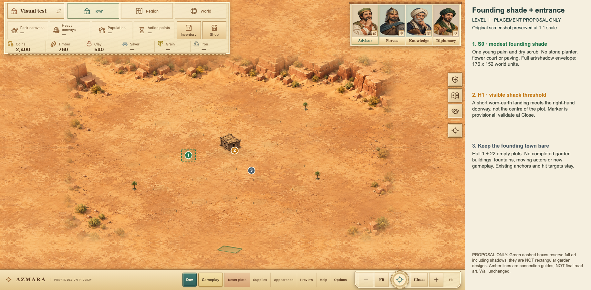
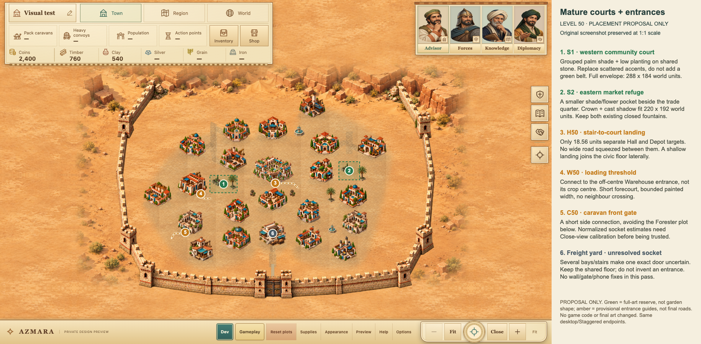

# Oasis Town — shaded pockets and entrances

11 October 2026 · DEC-074 · Proposal only · Awaiting implementation approval

- One small founding shade refuge; two composed mature garden courts.
- Doorway landings join the accepted shared town floor, rather than connecting
  to arbitrary plot edges. No new perimeter-road web.
- Same desktop/Staggered endpoints. No plot moves, wall work, motion, phone
  rollout or publication. Existing good building pixels remain.

The Owner's “yeh” answered “Shall I draft that next step?” and authorises this
draft, not its implementation. The ground direction is already accepted under
DEC-073. These are original AZMARA proposals, not copied reference-game designs.

## Marked screenshots

Actual unchanged 1440×900 game captures with offline annotation. Green dashed
rectangles reserve **full sprite/canopy/shadow envelopes**, not rectangular
garden designs. Amber guides show tentative entrance connections, not final
road art. Source pixels outside the annotation remain identical. The appended
legend is document space, not new HUD. No final art was generated.

### Level 1

### Level 50

## Garden composition

Replace the current scattered palm/garden/planter accents with a small coherent
family. This is not a continuous lawn, a green wall border, more owned buildings
or a park on every plot. Keep the mature town's two closed fountains separate;
no rills, streams or functional water system.

| Motif | Center, world units | Complete art envelope | Proposed content |
| --- | --- | --- | --- |
| S0 founding refuge | (1580,1297) | 176×152 | One young palm, sparse dry scrub and dusty ground. No stone planter base, flower bed, finished paving or fountain. |
| S1 western community court | (1580,1297) | 288×184 | Small grouped palm shade, low planting and restrained worn stone that merges into existing public paving. |
| S2 eastern market refuge | (2910,1156) | 220×192 | One compact shaded planting group with a modest seating/cloth-shade accent if it fits; not a market building or extra stall. |

The full mature bounds are West `(1436,1205)–(1724,1389)` and East
`(2800,1060)–(3020,1252)`. Minimum proposed clearance is 24 world units beyond
full protected plot/HUD/wall envelopes. Measured nearest plot gaps are 26 and 25
respectively. The founding envelope has 52.896 units minimum plot clearance.
At Fit, the mature groups occupy only about 71×45 and 54×47 CSS pixels; scale them
as intimate shade courts, not large gardens. Don't enlarge anchors or shrink
targets to make more foliage fit.

Reserve the whole crown, stone/soil contact and baked shadow. A clear ground
patch is not sufficient if a palm crown would hide a neighboring building.
The West envelope was lowered to leave clearance beyond the existing Workshop
apron connector. New approaches must respect the complete compound envelope.

## Entrances: register the visible threshold

Current code estimates contact at Hall 900/1024 or other-crop 92%, defines a
generic “door” at target-bottom+8, and can route to whichever rectangle side is
nearest. Those are not authored entrance sockets. Proposed first implementation
calibrates **four art states**: Hall1, Hall50, Warehouse50, Caravan Station50.
The shared Caravan socket is checked at both dedicated stations, with separate
clearance-aware connections. This does not claim all30 types/11 stages are mapped.

Below are provisional visual estimates, **not final verified socket metadata**:

| Art | Source/crop | Threshold `(u,v)` | Fitted world point in this fixture |
| --- | --- | --- | --- |
| Hall1 | Full1536×1024 PNG | (.63,.79) | (2159.8,1238.933) |
| Hall50 | Full1536×1024 PNG | (.56,.95) | (2127.6,1288) |
| Warehouse50 | Crop `[627,875,306,258]` | (.78,.90) | (1339.6,1401.025) |
| Caravan Station50 | Crop `[625,797,316,311]` | (.30,.90) | West(1175.132,1808), East(2915.132,1808) |
| Freight Depot50 | Multiple loading bays/stairs | Unresolved | No exact socket assigned |

Normalize to the checked full PNG/crop including its padding, not the click
rectangle. Compute its actual uniform `meet` body box, then
`worldPort=(bodyLeft+u*bodyWidth, bodyTop+v*bodyHeight)`. Key metadata by building
type **and source art stage/crop**. Don't apply a50 port to a wooden shack or
reuse it blindly through levels. Estimates can vary by roughly.03–.05 UV;
Close screenshots must establish the final visible threshold and outward angle.

Paint may enter its **own** footprint under its steps; it must not cross another
full body/control, garden crown or reserved wall/HUD area. Where the art has no
clear entrance, retain its existing shared public floor instead of inventing
a gate. Freight Depot's yard remains unresolved in this pass. Other uncalibrated
types keep their current floors/ground contacts; no all-plot route guarantee.

### Hall's narrow front gap

Hall bottom is 1303.333; Depot top is 1321.896. The gap is only 18.563 world units
(4.58 CSS pixels at Fit). A 55-unit road with a 68-unit painted envelope cannot
fit there. Neither plot nor its target moves.

Use a shallow Hall stair landing and narrow lateral pedestrian connection into
the accepted civic floor. Proposed guide:
`(2127.6,1288) → (2230,1288) → (2320,1290) → (2370,1340)`.
Maximum complete painted width 28, including shoulders, plus 8 units reserve.
This clears neighboring full envelopes while allowing paint under the Hall's
own steps. It is a landing/footway, not a wagon boulevard or functional route.

Hall 1 gets only a short worn-earth threshold patch to `(2177,1280)`, maximum
complete width 24. The Warehouse gets a short loading forecourt into the western
shared floor. The west Caravan connection turns sideways to avoid the Forester
plot beneath it; the east station needs its own verified route, not a blindly
mirrored street. Any rounding, kerb or new shadow must stay within the declared
paint envelope and be rechecked. No long algorithmic boundary detours.
The Warehouse guide's complete painted width is 40; the west Caravan guide's
is 32, both with 8 units extra clearance. Their checks include the two retained
fountains. The Caravan route has only 3.415 units spare beyond that safety margin
near the Forester plot: do not widen or curve it unchecked. Guides are not
final art or approved transport/collision dimensions.

## Art, depth and budget

Keep the accepted ground PNGs, street material and all existing building art.
Reuse the two registered closed fountain crops. The current palm has a formal
stone planter, so it is **not** appropriate unchanged for a poor founding camp.
Unregistered pergola/bench/shrub/court crops overlap neighboring atlas paint;
do not make ad-hoc cropped replacements or hide the problem by clipping bases.

If approved, request **one original transparent atlas with three independently
owned motifs** (S0/S1/S2), not three new ground maps or building redesigns.
Use only AZMARA's own accepted art as angle/light/material references. Target
≤1536×1536 pixels (≤9 MiB RGBA pixel data before caches), with enough padding and
full bodies/shadows; actual output dimensions, compressed size and crop ownership
must be checked. This desktop source budget is not phone performance approval.
At most two generation attempts for that image; if unsuitable, report the
missing art rather than extending the generation loop.

Use the same elevated orthographic/dimetric illustration, warm upper-left sun,
lower-right warm shadows, dusty green planting and restrained teal cloth.
Ground/contact/shadow has one owner. Blend the compound floor into the existing
soil/paving without rectangle borders, raised board-game pads or CSS glow.
No camera change, true 3D claim, engine/library/plugin installation or motion.

Draw order remains ground → shared floor/doorstep paths → owned pocket shade/
body artwork → existing wall back layer → DOM plots/buildings → unchanged wall
front/gate control → HUD/dialogs. Pockets are pointer-transparent scenery.
No new click targets, actor sorting, pathfinding, collision or economic effects.

## Proposed implementation boundary and rollback

Future files: `prototype/oasis-town.js` for compound placement and selected
source-keyed entrance metadata; one new atlas/brief under
`prototype/assets/oasis-pilot/`; `prototype/index.html` only if its module cache
version needs updating; new isolated QA/evidence plus documentation. Do not
alter `building-art.js`, existing art, wall source/assets, layout definitions,
saves/queue code, native bundle or staged Site. No move of existing files.

Risks: opaque atlas fringes/crop contamination, duplicate shadows, guessed door
positions, crowns crossing targets, cramped Hall/Depot connections, unnatural
art at Fit vs Close, or extra image memory. Mitigate with explicit full-body
registration, one shadow owner, type/stage ports, declared paint extents and
direct screenshot review. If a safe connection cannot fit, omit it and explain;
don't move a plot, shrink a control or turn a new floor into collision geometry.

Before implementation, retain the current scoped module/index copies outside
historical evidence. Rollback only that new presentation wiring/cache version
to the accepted pilot and stop loading the new atlas. No resets, migrations,
whole-repository rollback or deletion of evidence. Saves/queues stay untouched.

Acceptance checks: founding/mature 1440×900 Fit and Close; a mixed actual-level
fixture; exact v3/legacy bytes and paid receipt/deadline; unchanged 23 roles/
anchors and fallback gates; full art/shadow/paint clearance; all existing click/
keyboard targets; correct source-stage port mapping; owned browser/server
cleanup. Open every final visual screenshot before handoff. Known Close-camera
mode shift, old-atlas softness and paused wall/phone defects remain separate.

## Evidence and stop point

Read-only fixtures retain the actual screen CTM and uniform sprite boxes in
`evidence/2026-10-11-oasis-pocket-proposal/measurement-receipt.json`. Captures
have zero reported errors, stable runtime hashes, unchanged isolated storage
and closed owned browsers/servers. Extra geometry validation is in that same
new folder. Offline annotation receipt records source/output hashes, CTM and
zero changed pixels outside the markup; Root opened both final annotated PNGs.

The proposal guard protects runtime/tests/art, native, staged hosting and
historical wall/pilot/study evidence. No game implementation or final art was
created by this draft. Original pilot evidence/QA receipts remain historical.

**Await Owner OK for this small implementation pass.** Five-layout/all-band/
phone rollout, ambient movement, rills, wall repairs and publication are still
outside it. No historical wall defect is fixed or declared obsolete here.
