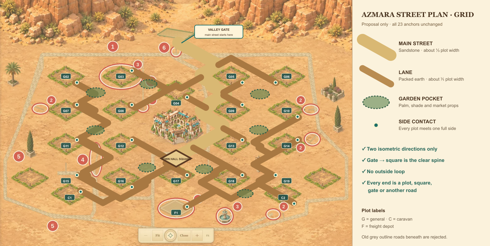
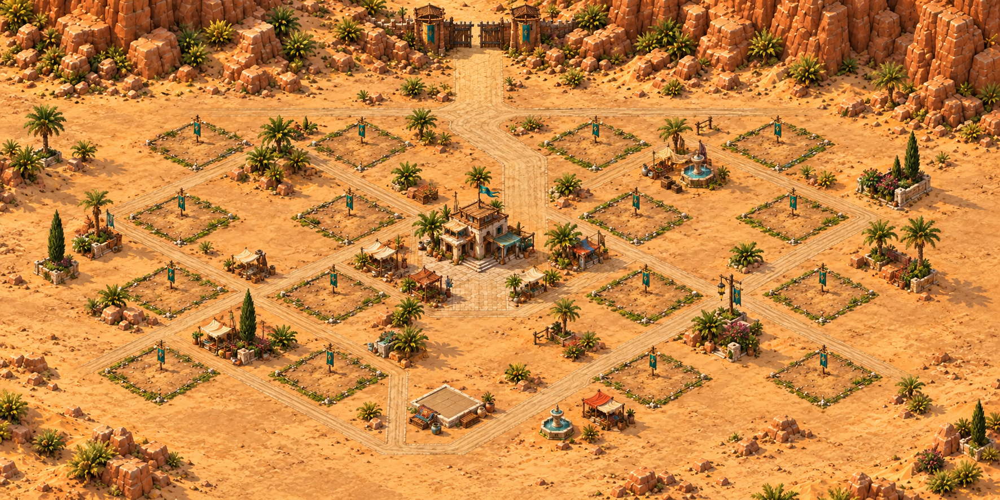
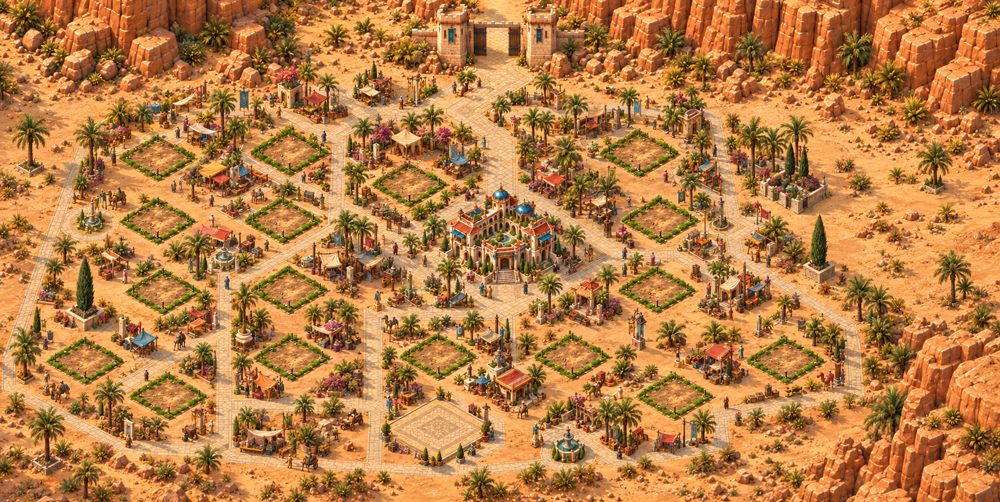
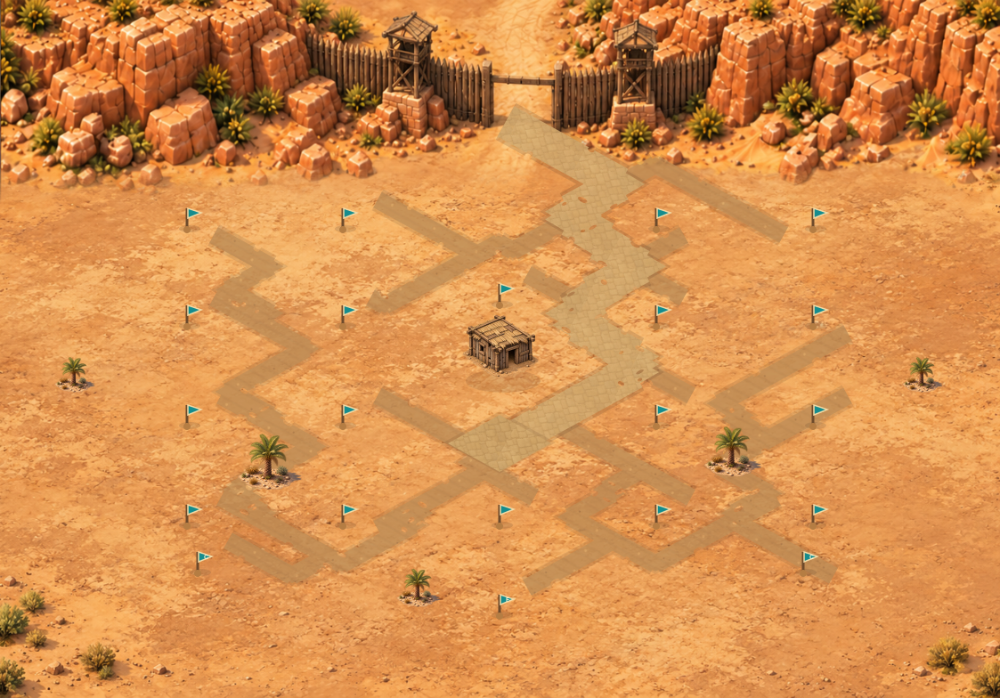
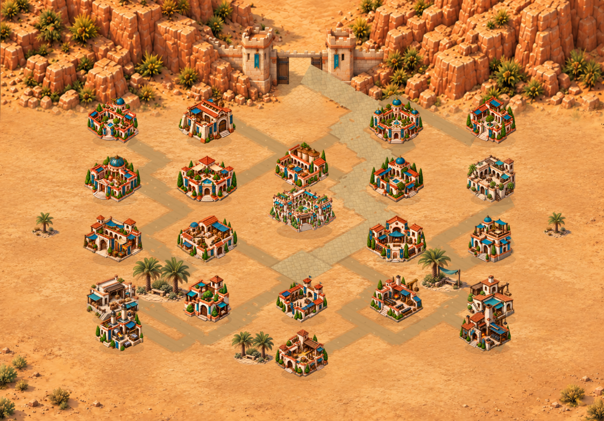

# Street direction study

The road redesign now has one exact manually composed review target. The earlier
two generated concepts remain rejected evidence because they reintroduced
forbidden horizontal and vertical streets. The manual target preserves the
verified Grid anchors and route instead of asking image generation to infer the
geometry. It is still proposal-only: the live roads and wall remain unchanged.

## Dev building size control

Dev Appearance review now has an unsaved1%–100% whole-number slider alongside
the existing100%,80% and65% presets. It changes only the isolated comparison
art: the camera, plot positions, saved town, construction queue and resources do
not change. Plot controls remain at least44px even when the visible artwork is
very small.

The current recommendation remains80%. It exposes enough ground for streets and
landscaping while preserving more building identity than65%, especially for
small industrial buildings and phone-sized views. This is not a default rollout.

## Grid street route

The diagram is a geometry plan, not the intended painted finish. The old grey
outline roads visible beneath it are explicitly rejected. The new route uses a
wider gate-to-square spine and narrower side lanes. Every generated segment is
restricted to the two isometric plot-edge directions.

- Main street: valley gate to the diamond-oriented square below the Town Hall;
  target width about one third of a plot.
- Lanes: packed-earth branches; target width about one fifth of a plot.
- Fixed roles: the wall plot is the gate origin, the Hall meets the civic square,
  both Caravan plots and the Freight Depot receive side contacts.
- General plot side contacts: G02/G05/G10/G16 use SE; G06 uses SW; G19 uses NW;
  all other general plots use NE in this first route.
- Fixed-role side contacts: C1 and F1 use NE; C2 uses SE.
- No anchor is moved. Gardens and small props occupy the remaining pockets.

The route is intentionally a tree rather than an outside loop. Its leaves are
plot sides; it has no decorative road ending in bare sand. Exact textured street
art for the other four layouts is deferred until a target is approved.

## Painted concept attempts

### Start of game — rejected

What works: the canyon gate is integrated into the cliffs, the town has more
depth, and modest vegetation and roadside props help the desert feel inhabited.

Why it fails: the gate approach contains a straight vertical segment, a broad
horizontal cross street appears below the canyon, and the empty sites are still
large outlined pads rather than small pins. This is not the target.

### Level 50 — rejected

What works: the metropolis feels active and prosperous, with markets, palms,
fountains, shade and better ground coverage. The two-tower wall is embedded into
the canyon rather than ending in open sand.

Why it fails: many streets are horizontal or vertical, several branches create
a loose outer circuit, the exact plot layout drifts, and some sites remain empty.
This is not the target.

Both allowed concept attempts have therefore been used. A third generated pass
was not made.

## Exact manual target — pending Owner approval

### Start of game

### Level 50

These are static desktop/Grid compositions at the recommended80% building
scale. They reuse the approved canyon top composition and original AZMARA
ground, progression and shade assets. No Ikariam image or new generated art is
used. The route and surface are composed deterministically in
`street-study/manual-compose.cjs`; `street-study/manual-street-target.json`
records its anchors, contacts and validation result.

- All street segments use the two plot-edge axes, with absolute screen slopes
  `0.55` and `-0.55`; no horizontal or vertical segment is present.
- The sandstone main street enters through the canyon gate, bends around the
  fixed sites and meets the diamond civic square below the Town Hall.
- Packed-earth lanes retain the verified side contact for every one of the21
  non-Hall/non-wall sites. Joined masks create one painted network instead of
  overlapping line strokes. Its edges are cut unevenly into the ground.
- The network remains a tree: no outside ring and no leaf ending in empty sand.
  Its leaves are the21 plot contacts; the Hall is served by the square and the
  wall role is the gate.
- Empty sites use small turquoise stakes with no always-visible plot diamond.
  Building footprints retain painted shadows; open pockets use existing desert
  shade/palm art rather than board-game garden tokens.
- Start and Level50 deliberately share the same street geometry. Later lane
  upgrading is reserved; this proposal does not introduce a new level rule.

The canyon crop is visually feathered into the ground. That is a paint-over
technique for this review image, not a runtime layer or approval to change the
wall. If accepted, Step2 should bake the road network into sharp static ground
art rather than reproduce the mock-up as live SVG strokes.

## Implementation boundary

No road or wall game code changed. Step2 should begin only after the exact
manual target above is approved. The recommended implementation method remains
one baked textured ground image per layout: it preserves exact geometry, stays
sharp at maximum zoom and avoids runtime SVG line/filter artifacts. The other
four layouts, phone crops and any level-band variants remain unbuilt.

## Verification

- Offline pure comparison:4,000 slider scenes covering100 values, five layouts,
  four development levels and desktop/compact profiles passed.
- Published web22 normal Oasis output is unchanged for60 normal comparison cases;
  held Levels24 and26 remain inactive.
- All30 building identities and source crops passed the existing270-case check.
- Protected construction, save, queue, anchor and parser invariants passed.
- Browser interaction and screenshots were not run because no new browser launch
  was authorised. The Owner can review the local slider manually.
- Both manual PNGs were opened and inspected after composition. Their SVG
  sources parse with the XML parser's large-input mode; both PNGs are1123×784.
  The manifest confirms21/21 side contacts and only the two allowed axes.
