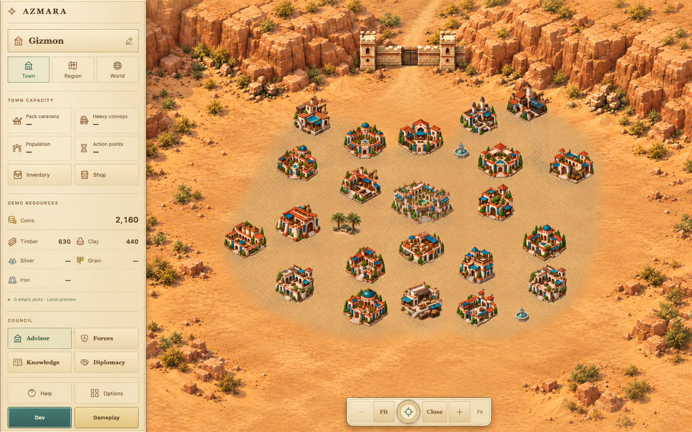
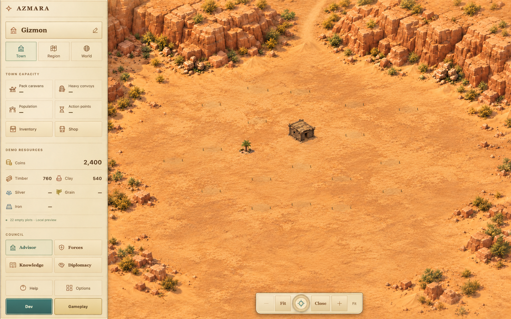
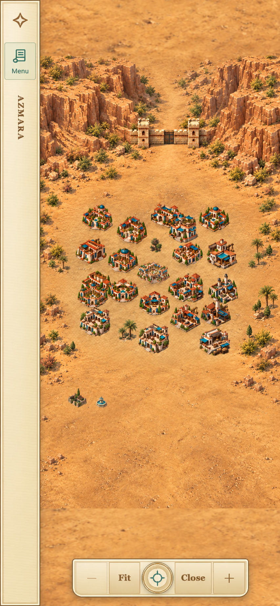
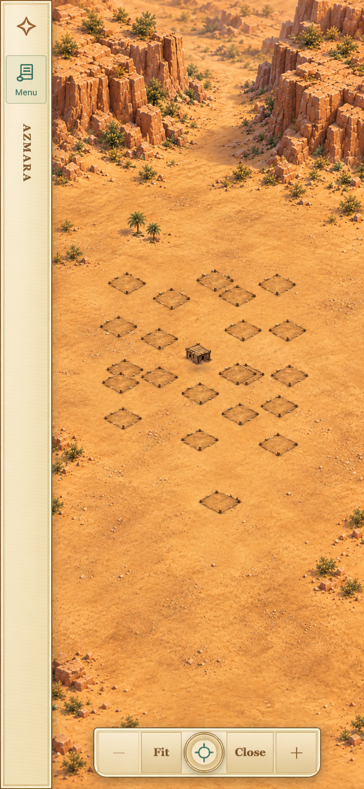
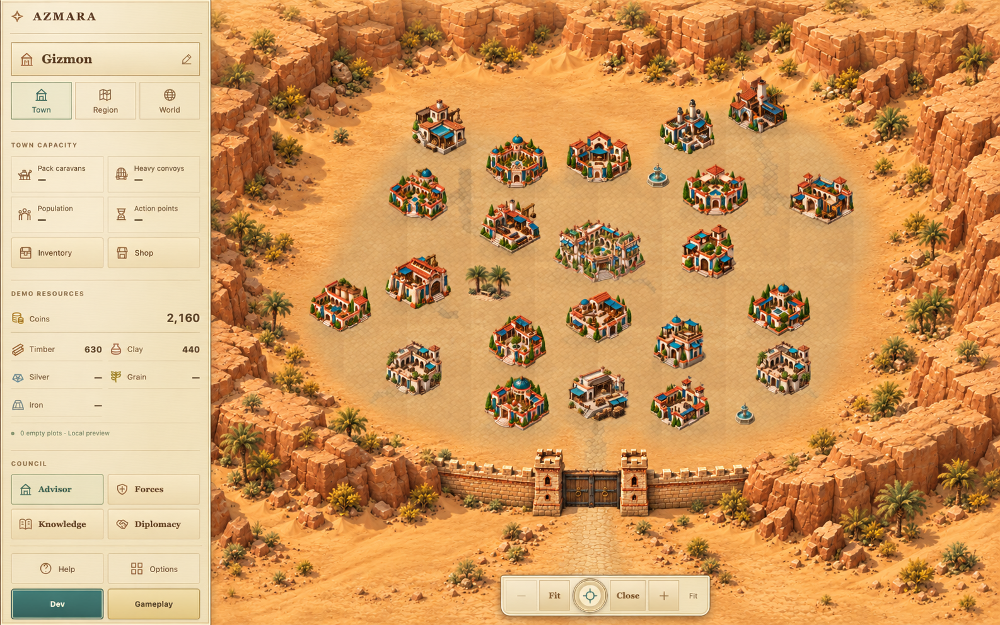

# Valley wall composition — original proposal, A subsequently authorized

Subsequent status: DEC-086 now authorizes implementing and publishing A,
including wall-01's rear-gate relocation. See the
[implementation review](../implemented/REAR_VALLEY_WALL.md). The concepts and
original constraints below are retained as proposal-time history, not a current
instruction to leave the runtime unchanged. B remains unapproved.

12 October 2026. DEC-082/083. Owner picked the rear-pass desktop concept as
“most correct design”. This records that visual preference, **not approval to
replace the current wall route, move a fixed anchor or create final wall art**.

## A — rear/northern pass (recommended, Owner-preferred)

Bring the upper cliff shoulders down toward a narrow pass behind the town.
A single wall and gate cross that pass. Its two ends meet rock; no side
returns, front curtain or perimeter ring. The broad plain in front remains
open so the playable settlement dominates rather than outer scenery.
At the real start only the wooden Hall is built; the pass is open, with no
wall/towers. Level50 below is an ideal-town visual review, not saved progress.

Phone concepts use the same reserved menu strip and proposed quiet Oasis
ground, not the actual compact renderer:

I recommend A because it preserves the Owner's selected composition, keeps
the southern playfield visually open and removes the repeated perimeter-wall
silhouette. It is a rear-pass checkpoint, not a defensible all-around enclosure;
no simulation or defence bonus change is implied.

## B — town inside a valley, front closure (alternative only)

Cliffs frame both sides of the town; one gate wall closes the southern open
end and the incoming road reaches it from the foreground. This gives a more
obvious protected basin and aligns more naturally with the current front wall
control, but frames the playfield more tightly. Owner preferred A, so B is
retained only for comparison, not the implementation recommendation.

Other B concepts: [desktop start](valley-wall-study/b-valley-desktop-start-v1.png),
[phone start](valley-wall-study/b-valley-phone-start-v1.png),
[phone50](valley-wall-study/b-valley-phone-50-v1.png).

## Wall levels / art

Retain the existing building identity `wall-01`, actual saved level and stable,
uneven milestones `1,6,11,15,20,24,30,33,40,44,50`. Material grouping would
stay timber1–10, adobe11–32 and sandstone33–50. Hall level does not silently
build or upgrade the wall. A start town has an unbuilt wall; a built level1
wall would be a rough timber barrier, not the mature stone concept.

New approved-route art would need one cohesive original short span per
material, with the same building camera angle, warm upper-left light, contact
shadows and scale. Timber: stakes, braced gate and modest watch platforms.
Adobe: thicker earthen curtain and square towers. Sandstone: dressed blocks,
two stronger gate towers and restrained crenellation. No repeated pasted
segments, extra decorative towers or perspective narrowing like a photograph.
Keep the source split into registered back/front paint layers where necessary.
No such final assets have been generated in this task.

## Fixed anchors and five layouts — unresolved route dependency

The current base wall anchor is desktop `(2100,2090)`, compact-core-local
`(680,1530)`; completed-wall presentation currently projects it to the front
gate route (desktop `(2100,2490)`). A's painted rear gate is not there.
The concept is not a measured world-coordinate route.

Before implementing A, obtain explicit approval for how its visible wall
control is registered while preserving the saved identity. Do not silently
relocate the fixed anchor, add a hidden hit proxy or put an unrelated second
wall button at the front. Under the present fixed-anchor constraint this
alignment is **not solved**. A composition OK alone does not authorize it.

Staggered, Grid, Circle, Avenues and Garden quarters remain. All23 IDs, saves,
queues, Hall and three transport base anchors stay fixed; no other plot moves
are proposed. The future cliff and wall envelope must clear the union of all
five actual layouts and full building art/shadows/targets, not just the
Staggered illustration. If it cannot, revise terrain outside that union or
bring the conflict back to the Owner. No layout/anchor edit has been made.

## Open Step5 defects

| Existing issue | Consequence of A if separately approved |
|---|---|
| Extra painted perimeter towers / repeated side walls | Their current route becomes obsolete; do not repair it now. New two-tower short-span art still needs checking. |
| Gate hit area not matching paint | Still needed; rear-pass/front-anchor conflict above must be resolved explicitly. |
| Phone Fit / wall crowding | Still needed against the new registered art bounds and remaining viewport. This phone paint-over is not a Fit test. |
| Wall scale, cliff joins and back/front registration | Still needed for the short span. Check shadow/body bounds and buildings against the approved route. |
| Mature phone ground / backdrop seam | Not fixed by a wall concept or sidebar; a separate compact scenery implementation is required. |

No Step5 defect is marked fixed in the actual game by these images.

## Oasis scenery consequences

Keep accepted original earth/paving, building stages, shade motifs, closed
fountains and calibrated entrance art. Replace only the composition of the
rear terrain and, if approved later, the ring-wall exclusions/approach with
the short pass/cliff envelopes. Do not turn the whole phone picture into a
background: it would duplicate buildings, lose hit registration and break
five layouts.

Start remains bare earth with one modest refuge, not a finished city.
Level50 retains shared paving, sparse palms and quiet courts. Routes must
connect real doorways without crossing full building footprints. A new
northern main approach would require a measured routing plan; no route is
quietly changed in the paint-over. Ornamental rills/motion remain unapproved.
The existing24/26 reuse plan stays held until sidebar and valley review; its
world/paint/HUD clearances and separate Caravan20 entrances must be rechecked.

## Fidelity / provenance

Eight original proposal PNGs, one attempt each (maximum two permitted).
AZMARA-only actual sidebar captures were inputs; no other game's art, UI,
layout, colours or text was used as generation input. No local pixel edits
were made. Originals are retained; these are byte-exact copies.
Exact prompts/paths: [initial five records](valley-wall-study/generation-prompts.json),
[three preferred-A records](valley-wall-study/preferred-a-prompts.json).

Root opened every saved concept. UI labels, buildings and site positions are
generatively approximate, not a pixel-exact compositing/coordinate proof.
Desktop start markers are faint; phone start outlines are illustrative.
A phone50 retains a horizontal terrain transition near its lower controls
and an oversized empty margin; do not ship that seam or scale it as final
terrain. The intended correction is one continuous painted ground surface,
with Fit calculated from registered live content. No extra generation retry
is needed to decide the composition. Actual sidebar screenshots in
[the local review](../implemented/SIDEBAR_VALLEY_REVIEW.md) are authoritative.

## Future scope, risk and undo — no changes now

If approved separately: new terrain/short-wall assets and registrations in
`prototype/town-wall.js`, scenery/ground integration in `oasis-town.js`,
and only necessary presentation/cache/camera registration files. Exact source
and anchor-control scope must be settled before that implementation starts.
No engine/library switch, file migration, gameplay/save change or native update.

Risks: cliff overlap in another layout, phone crowding, gate/control mismatch,
paint angle/scale mismatch, memory from oversized transparent terrain, and
reintroducing pasted-piece seams. Use one bounded art pass and measured
desktop/compact/phone checks, not an unbounded whole-town redraw.

Undo: retain current ring/U-wall PNGs, source registrations and this task's
evidence; never overwrite them for the concept. No wall runtime rollback is
needed today because it was not edited. The sidebar has its own six-file
rollback documented separately. No hosting/native state changed.

Stop for Owner OK on this proposal and the unresolved anchor handling before
any valley wall implementation.
