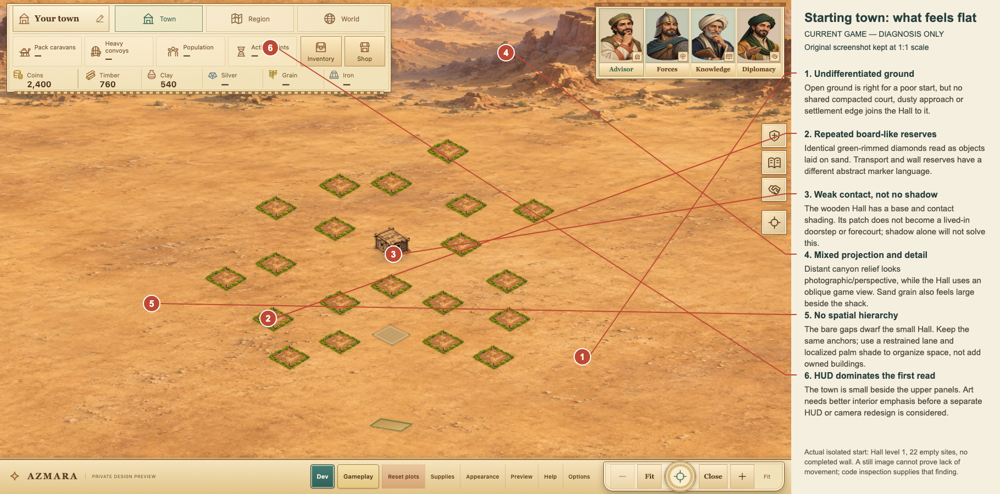
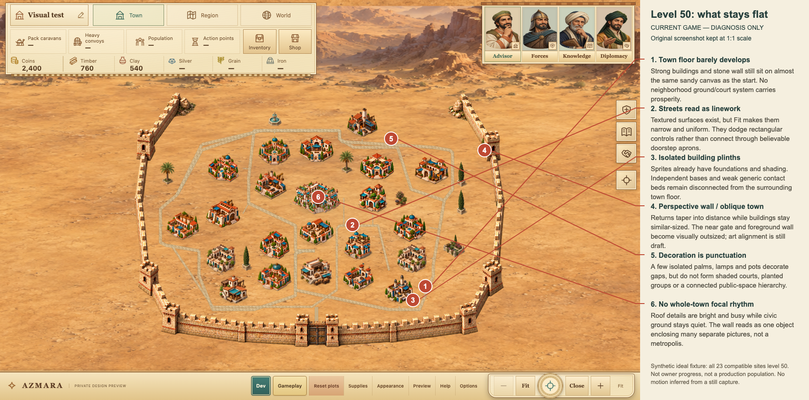
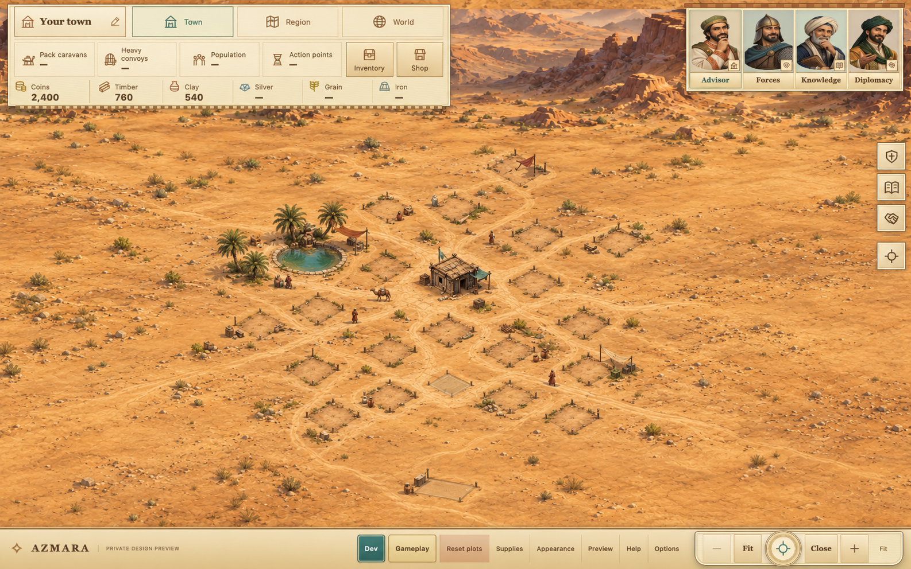
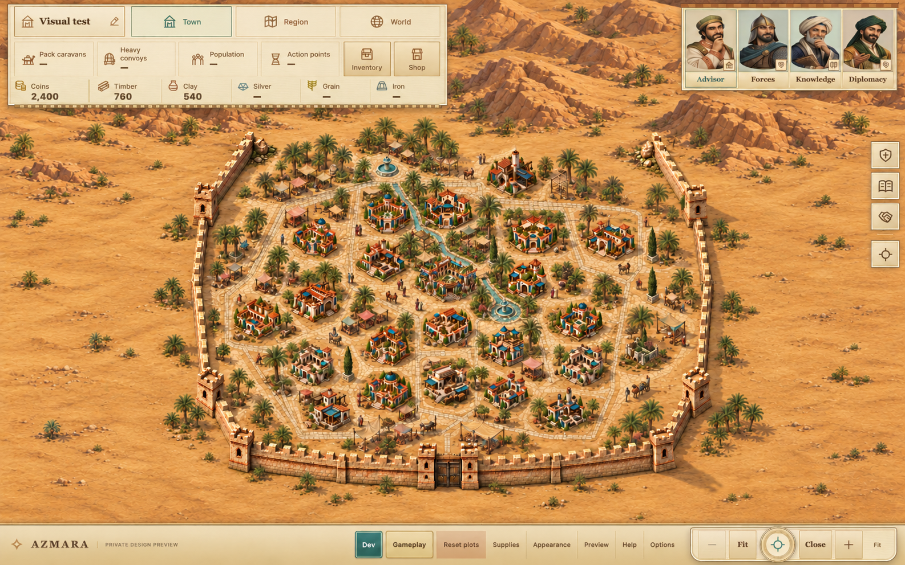
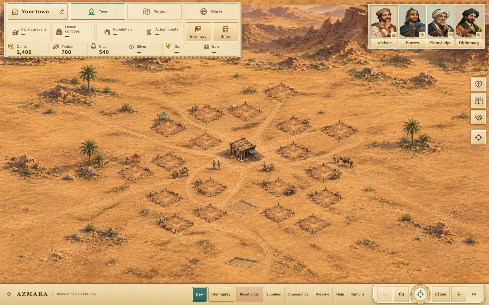
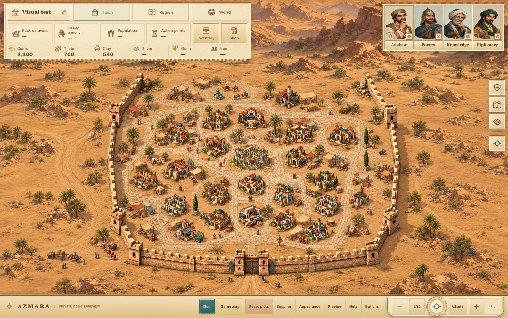

# AZMARA — visual direction study

11 October 2026. **Proposal only; awaiting Owner OK. Step 5 is paused.**

## Recommendation in brief

Choose **Oasis Town**: a desert settlement whose prosperity is visible in its
shared ground, shade and public spaces, not just more elaborate roof sprites.
Keep the good original buildings. Connect them with believable streets,
doorstep courts, localized palms, small enclosed water features and restrained
market life. Caravan Court is the drier alternative below.

This does **not** require a true-3D engine. It needs a consistent illustrated
orthographic/2.5D art system and better integration. Animation comes last;
moving stickers over unchanged sand would not repair the composition.

No game code, runtime art, plot anchors, saves, queues, native bundle or Site
was changed. The existing `evidence/2026-10-11-wall-build/` remains untouched.
Current published version 19 stays an unfinished draft; there was no new
publication. Nothing here resumes Step 5 or approves replacement wall art.

## Evidence and comparison boundaries

- **Observed, AZMARA:** fresh local Staggered desktop screenshots at 1440×900,
  opened and inspected. Start = Town Hall level 1 and 22 empty sites, with no
  completed wall. Level 50 = synthetic all-23-occupied ideal fixture, not Owner
  progress or a promised population/production state. Capture receipts record
  zero browser errors and owned browser/server closure.
- **Observed, supplied Ikariam still:** streets meet useful destinations;
  shared courts, planting masses and human-scale details visually join separate
  buildings into a town. A still image does not establish its animation or
  gameplay. Those cohesion principles—not its art, layout, colours, interface
  or words—inform this study. No fresh live-game inspection was performed.
- **Inferred:** AZMARA feels pasted together because ground, projection,
  relative scale, contact and public-space hierarchy disagree.
- **Proposed:** all art rules, appearance bands, asset budgets and estimates
  below. They are not accepted game balance, historical facts or implementation.

Only original AZMARA screenshots were given to built-in ImageGen. No Ikariam
image, pixel crop or style image was used. Existing AZMARA architecture informed
the paint-overs; generative outputs are approximate, not exact reused sprite
pixels. Originals and annotations are separate from concept images.

## 1. Diagnosis

| Owner hypothesis | Check and qualification | Main cause / ownership |
|---|---|---|
| Flat sand everywhere | Agree perceptually, although the sand is textured. The mature interior barely differs from outside or from the start. | `app.js` currently overrides every Hall terrain stage with the same v18 mountain painting; the cosmetic maintained-ground wash is too faint. |
| Paths are outline lines | Agree at Fit, not literally: SVG paving has material texture and inset shading. Its small, nearly uniform painted width still reads as linework. | `building-art.js` street rendering and routing; approaches protect control rectangles, not authored doorway/apron positions. |
| Empty plots are board tiles | Agree. Repeated green-rimmed rhombi are especially wrong for a poor desert beginning; other reserves use a different abstract token language. | `app.js` empty-art selection; existing plot/reserve images. |
| Buildings have no shadow/footprint | Challenge the literal claim. PNGs have foundations/contact shading; CSS already adds radial beds and drop-shadows. Their independent plinths do not join a shared town floor. | `styles.css:58–59`, sprite registrations and ground integration. Adding another shadow everywhere could double-darken them. |
| Photo-like canyon vs isometric town | Agree. The backdrop has horizon-like recession; the constant-scale buildings do not. The wall returns add another perspective cue. | Painting direction plus nonuniform terrain stretching in `app.js`; wall source art. |
| Large gaps; nothing moves | Agree on unstructured gaps. Code inspection finds camera/UI movement and timers, not ambient town actors. A still capture alone cannot prove this. | Ground/public-space composition first; small cosmetic motion later. |

Additional findings:

1. **No intermediate scale.** Roof details are rich, but there are few yard
   edges, door approaches, shade groups or public courts between building and
   landscape scale. Scattered ornaments read as punctuation, not neighbourhoods.
2. **No civic focal ground.** The Hall has a good silhouette but no legible
   forecourt that organizes adjacent streets. Uniformly bright architecture
   competes with it.
3. **Texture and baseline inconsistency.** Enlarged sand grain and different
   sprite padding/base heights make relative scale uncertain. Generic rectangular
   fitting does not guarantee a common ground contact point.
4. **Composition remains wall-led.** Strongest-wall Fit reserves influence even
   an empty start. Substantial outside sand and large upper HUD panels reduce
   the perceived town. More scenery at the edges would worsen this.
5. **Public/private ground is indistinct.** A civic court, freight yard, workshop
   apron and garden should not all be the same sandy rectangle. Ground can
   express use without inventing another owned building.

The relevant source paths are `prototype/app.js` (`appearanceFor`, terrain
placement, Fit/footprints), `building-art.js` (`terrainOverlay`, layout/routing,
native sprite crops), `styles.css`, `progression.js` and `town-wall.js`.
Current native-art road width reaches 12 pixels for main lanes and 2.5–5 for
local approaches; these are **native painting pixels**, not world units or
screen pixels. The backdrop is stretched to 9400×4050 world units on desktop
and 4000×4160 on compact. This is not one uniform art-to-world scale.

### Annotated actual screenshots

The unchanged original 1440×900 screen is retained at 1:1 scale inside each
1820×900 diagnostic image. Numbered marks, leader lines and a side legend are
the only additions. These are not generated evidence or implemented changes.

Originals: [start](visual-direction-study/current-start-desktop.png) and
[Level 50](visual-direction-study/current-level-50-desktop.png).

## 2. Draft common art rules

### Camera, ground and light

- One elevated **orthographic/dimetric illustration** for playable ground,
  props, buildings and fortifications. Start calibration around 35° camera
  elevation, ground axes approximately ±30° on screen, verticals vertical.
  These are draft art targets, not recovered camera metadata: the PNGs have
  no underlying camera scene. Calibrate against the existing Hall and two
  ordinary sprites before commissioning production ground.
- No vanishing point, no size shrink across the playable town, no sky/horizon
  strip. Rear ridges remain dimensional but use the same view, lower contrast
  and broader shapes. Do not turn them into a front/side canyon enclosure.
- Register ground and sprites in the real world plane: `(0,0)` upper-left,
  X right, Y down. Preserve current desktop/compact anchor sets and actual
  SVG camera transform. Never stretch X and Y independently to force a fit.
- Sun comes from screen upper-left. Lit roof/top faces warm and pale; shaded
  faces warm brown. Ground shadows travel consistently lower-right, roughly
  screen vector `(1,0.55)` before calibration. No outline halos, floating
  kerbs, glow rings or photograph-style bloom.
- Every object has one defined ground-contact baseline, optional door port
  and owned shadow. Preserve its full visible body, contact/shadow envelope
  and accessible control. No positional jitter between upgrades.

### Palette and detail hierarchy

Proposed AZMARA-derived swatches—not a sampled reference-game palette:

| Use | Draft colour |
|---|---|
| Open desert / hard-packed soil | sand `#C7A16A`, ochre `#B88750` |
| Clean street stone / civic courts | buff `#D6C7A6`, pale limestone `#E2D4B5` |
| Adobe / brick accents | clay `#A96543`, muted terracotta `#9A5037` |
| Timber / contact shade | walnut `#58402C`, brown `#705438` |
| Existing cloth identity | restrained teal `#397C78` |
| Planted pockets | date green `#3F6044`, dusty sage `#7C8B56` |
| Enclosed pools / ornamental rills | muted blue-green `#4D8F88` |

Keep most ground low-contrast, architecture crisp, planted shade grouped and
water small. Mature town can have 15–25% planted/shaded public ground as an art
target, **not continuous lawn or forest**. Outside remains dry. Hall court and
street destinations carry hierarchy; no giant rocky noise in the playing field.

### Scale chart

Painted dimensions below are starting **desktop-reference world-unit budgets**, not changes to
save levels, physics or plot positions. Use a person around 30 units high as
the calibration ruler; verify at Fit and Close, not only on an isolated atlas.

| Object | Draft painted footprint width | Apparent vertical height | Scale intent |
|---|---:|---:|---|
| Person | 10–16 | 26–32 | Tiny but legible at Close; not a playable actor. |
| Date palm | canopy 70–110 | 120–180 | Groups frame courts; not taller than every civic building. |
| Ordinary house/workshop | 160–240 | 90–140 | 1–2-storey scale; fit within existing ordinary envelope. |
| Town Hall, level 1 | 130–200 | 80–110 | Modest timber shack, no palace paving. |
| Town Hall, level 50 | 330–410 | 180–240 | Civic focal building; current maximum envelope retained. |
| Timber wall | curtain thickness ~35 | 60–70 | Weak palisade; own level, not Hall level. |
| Strong wall / tower | curtain ~35, tower ~100 | curtain 100–140, tower up to 200 | Human-scale masonry, not an outsized castle fence. |

Current ordinary art envelopes remain desktop 320×270 and compact 220×190;
Hall envelopes remain 460×307 and 320×213 approximately. The proposed scale
chart is not a compact-profile size prescription: compact artwork must be
calibrated inside the existing 220/320-unit width envelopes without moving
anchors or enlarging targets. The desktop Hall widths must not be applied
unchanged on phone. The chart may expose incompatible sprite padding/viewpoints: flag those outliers
for review rather than silently resize anchors, controls or fixed roles.
No extra house sprites should be used as fake occupied plots to fill gaps.

### Shadows and footprints

Keep existing good baked shading. Audit it against the common sun before
adding anything. Under each building: a compact contact darkening, then a
feathered directional ground shadow and an irregular material apron appropriate
to its use. Contact is dark and tight; cast shadow is lighter and longer.
Use warm brown, roughly 18–28% cast opacity, 30–40% contact opacity; tune by
sprite so baked shadows are not doubled. Blur stays in ground-scale artwork,
not a full-scene CSS blur. Foundations merge through dusty edges, scuffs,
doorstep wear and small perimeter planting, not generic oval rugs.

## 3. Two directions — same town, desktop endpoints

Both directions use the **same actual source town**, Staggered anchors,
existing building identities and fixed-role sites. Level 1 is the real empty
start; Level 50 is the fully occupied ideal fixture. Occupancy differs between
the two levels, so not every perceived improvement is caused by ground art.
Within a given level the alternatives start from the same source fixture;
generation drift prevents a pixel- or geometry-controlled comparison.

These are **paint-over concepts, not exact anchor/count or interaction proofs**.
The generator re-rendered some sprites, small props and UI, and output 1586×992
instead of the source 1440×900. Building silhouettes/relative positions are
recognizable, but original source sprites and measured anchors—not mock-up
pixels—remain authoritative. Decorative stalls/people do not represent extra
owned buildings, population or functioning trade. No HUD redesign is proposed.

### A. Oasis Town — recommended

Level 1: dusty clearings with short survey stakes, a worn lane, one modest
oasis pocket and a few palms. Only the wooden Hall is owned/built; no completed
wall, grand fountains or marble boulevards. Empty sites stay available.

Level 50: connected sandstone streets and courts, a clear civic apron,
localized date-palm groves, garden shade, modest market spill and small enclosed
water features. It should feel maintained and inhabited without ceasing to be
a desert town. Short bounded ornamental rills are part of this proposal.

### B. Caravan Court — drier alternative

Level 1: compacted earth and wagon traces, sparse palms, rope/crate bundles and
patchwork shade. Same single Hall and empty reserves; no new permanent market.

Level 50: dry sandstone streets, service courts, freight aprons and woven
market shade. Water is limited to a small drinking/fountain basin. Merchant
activity supplies character instead of the oasis garden/rill network.

### What the mock-ups establish—and do not

Oasis Town best separates AZMARA from the current plain-sand presentation:
green is localized refuge and shade, not borrowed temperate landscape. Caravan
Court strongly supports the trade fantasy, but risks remaining visually dry
and uniform. Both improve floor/street ownership and intermediate-scale detail.
Keep Oasis Town's planted relief and Caravan Court's practical freight-yard
material language within their existing roles; do not combine all decoration
indiscriminately.

Five generation calls total: one each for four endpoint images, plus one
environmental correction for Oasis 50. Maximum two attempts per image was
respected. No unlimited cleanup loop. Residual generation problems are recorded
in the inspection notes below; the written rules override those mistakes.

## 4. Recommended direction — proposed implementation scope

### Designed ground, five layouts and progression

Use **authored ground/main-street plates**, registered per layout and profile,
not one random desert painting with lines over it. Keep occupied buildings,
empty site markers, footprints, terminal approaches, people and wall separate
from the plates. Plates never bake in owned buildings or a finished wall.

Use four proposed ground bands aligned to groups of the Hall's existing uneven
milestones `[1,5,8,12,17,22,28,34,41,45,50]`. This groups environmental art only;
it does not replace the eleven building stages or randomize an upgrade.

| Completed Hall levels | Ground band | Visible progression |
|---|---|---|
| 1–11 | Founding clearing | Hard-packed sand, dusty paths, rough pegged reserves, sparse shade. Detail at existing milestones stays restrained. |
| 12–27 | Settled town | Consolidated lanes, worn stone threshold aprons, small organized courts and first planted pockets. |
| 28–44 | Civic oasis | Proper sandstone streets, modest kerbs, shaded gardens, market courts, maintained ground and small closed pools/rills. |
| 45–50 | Metropolitan oasis | Clean continuous public paving, better finished civic court, mature shade groups and finer stone/material detailing—not bigger outer scenery. |

One plate design per band for each of Staggered, Grid, Circle, Avenues and
Garden quarters, in desktop and compact compositions. Street logic changes
with the arrangement: offset lanes for Staggered; block streets for Grid;
open rings/spurs for Circle; parallel routes for Avenues; connected public
courts for Garden quarters. No imported/reference layout. Each composition
must register against the **unchanged actual anchor map**, not invent a nicer
arrangement and force the plots onto it.

Do not generate 500 separate ground paintings for 50 integer levels. Small
shared detail/material variants can bridge existing milestones between the
four main bands. Hall upgrades develop the town floor; uncompleted queues do
not. Wall material still follows its own completed wall level.

### Streets and low-level local approaches

- Main streets form surfaces with usable width, paving direction, wear,
  shoulders and restrained kerbs. Draft widths: main 55–85 world units,
  local 30–45, with narrower constrained exceptions flagged in the layout
  proof. Width cannot be expanded through a sprite/control to look grand.
- Plate streets stop at safe neighbourhood junctions. Separate terminal
  approaches join registered door/apron ports, not the rectangle centre.
  Preserve `min(completed Hall, completed building)` local quality: a Hall 50
  town can have a paved main lane fading into a worn dirt apron at building 5.
  Blend material over a short terminal section, not a harsh half-road seam.
- Aprons/door ports are render metadata, not moved plot anchors or functional
  road simulation. Different building types can occupy a general site: their
  optional doorstep ports must be audited against each stage, with a safe
  generic court connection when a door cannot be identified.
- Ground masks protect full sprite, label and ≥44 CSS-pixel target envelopes.
  Sparse/empty plots in a high-Hall town remain free; no fake houses or
  occupied-market artwork gets baked into their reserves.

### Plot markers, contact and background

Replace crisp green diamond tokens with understated irregular clearings and
two or three survey stakes. Keep a distinctive rectangular **wall reserve**,
and recognizable caravan/freight yard cues, but one earth/material language.
Selection/keyboard focus must remain clear and accessible; do not hide empty
site affordances merely to make a prettier image. No plus buttons or blue
selection boxes are reintroduced.

Keep the existing building pixels wherever they match camera/light. Add
role-appropriate dusty or paved forecourts and restrained directional shadows
as needed, with one shadow owner. Calibrate baseline/footprint metadata instead
of changing saved levels or scaling every sprite to the same apparent house.

Replace the receding/photo-like canyon with shared illustrated rear ridge and
calm dry margin plates, one per profile. They remain behind the playable town;
no new outer explorable area, perspective shrink or enlarged mountains. Phone
requires its own composition rather than a horizontally squeezed desktop.

### Small moving details

Propose cosmetic loops only: one or two pedestrians on short clear street
segments, subtle cloth movement and a small pool glint. Later a pack animal
can replace one pedestrian in a transport yard—not be added without a budget.
No simulated population, trade trip, combat, pathfinding or collision implied.
Keep animations independent of savings/queues, pointer-transparent and out of
plot labels/controls. Nothing can cross a reserved plot or pass through wall art.

Phone: **up to four** simultaneous loops, typically two people, one cloth and
one water glint; starting town one or two. Desktop: up to twelve. Pause all
when hidden, stop offscreen loops, and make reduced motion fully static.
Animate small sprite transforms/opacity; no full-ground animation, large blur,
particles or unbounded per-frame DOM changes. Motion is subordinate to legibility.

### Existing art and the wall

Survives: all good Hall stages, original active building stages, compatible
legacy identifiers, portraits, icons and UI. Preserve originals byte-for-byte;
derive tighter current-stage exports later for delivery, never overwrite masters.
Existing usable palm/fountain crops can remain reference/prototype material;
inspect lighting, full-body crop ownership and scale before retaining them in
the final scenery atlas. No replacement of all 30 building types is proposed.

The wall remains **one building on `wall-01`**, with the current own-level
timber/adobe/sandstone rule, existing stable logical milestones, fixed route/
gate anchors and shared-source complementary back/front layering. No wall
route or construction behaviour changes in this study. Existing v19 wall art
is provisional: retain it unchanged for now; budget replacement masters later
to match the chosen camera/light/scale after ground direction acceptance.
Do not fix the eight-versus-six towers, target or camera by polishing discarded
art now. Replacement-art acceptance must still enforce the approved six tower
anchors; a mock-up is not permission to add towers or change the route.

### Each open Step 5 defect

“Fixed by direction” means a planned design treatment, **not a fix already made**.

| Open defect | Classification | What happens after direction approval |
|---|---|---|
| Eight painted towers vs six approved anchors | **Still needed; old pixel surgery obsolete if art is replaced.** | Replacement wall brief must respect six anchors and be visually counted. Keep present evidence. |
| Occupied gate hit area below the door | **Still needed.** | Register control to the final gate's visible arch/door using real world projection; preserve wall ID and ≥44px access. Pretty new ground cannot solve an invisible target. |
| Phone Fit overlapping plot targets / unexposed corners | **Still needed.** | Test unchanged anchors in all five layouts. Ground art cannot repair input overlap. If exposure needs anchor changes, stop and flag them; no silent re-layout. |
| Faint wall alpha fringe inflating Fit and empty foreground | **Source-specific workaround obsolete if art is replaced; clean-bounds verification still needed.** | New masters require clean transparency and honest baseline/body/shadow bounds; do not crop towers/shadows merely to tighten Fit. |
| Tapered wall / inconsistent scenery and building projection | **Addressed by new direction, awaiting proof.** | Calibrated orthographic plate/wall art, no X/Y stretch. Inspect all material bands. |
| Final all-five-layout × desktop/phone Fit and maximum-zoom acceptance | **Still needed.** | Check real sprites, pinned/hover labels, gate target, back/front joins, pixel registration, saves and exact queue receipts after the approved art is integrated. |

No Step 5 defect is closed by this study. Runtime repairs remain paused.

### Asset count — full recommended town scope

| New art deliverable | Count |
|---|---:|
| Ground/main-street plates: 5 layouts × 4 bands × 2 profiles | 40 |
| Shared rear-ridge/calm-margin plate per profile | 2 |
| Empty-site/role-marker atlas | 1 |
| Footprint/contact-shadow/local-approach material atlas | 1 |
| Palm/market-shade/public-space prop atlas | 1 |
| Small ambient-animation atlas | 1 |
| Replacement cohesive wall masters: 3 materials × 2 profiles, one PNG reused for complementary back/front clips | 6 |
| **Total new artwork images, including wall contingency** | **52** |

If current wall pixels are ultimately retained, total new artwork is **46**.
Do not order all 52 now: first prove the two desktop endpoint plates in one
layout. The four concept selections and two annotated screenshots are study
deliverables, **not** these future runtime assets; the extra Oasis attempt is
retained only as provenance.

Derived shipping files are a separate count: at most **330 tightly cropped
current-stage exports** for the 30 active types × 11 existing stages (including
the 11 existing Hall images), with legacy Shipyard sharing caravan art. These
reuse existing artwork, not 330 new commissions. Counting new delivery bitmaps
as well as new artwork gives an upper-bound **382 files** (52 + 330), before
optional resolution/format variants. Final exports may skip already-suitable
Hall images or unneeded field-wall samples. Do not decode entire eleven-stage
sheets just to display one building. Keep original sources and metadata.
Region/World redesign assets are **not included**; those surfaces should later
follow the same camera/material rules under their own approved scope.

### Phone budget — proposed acceptance targets, not a measured guarantee

The present ideal-town building files total about 31.63 MiB compressed and
131.97 MiB of RGBA pixel arithmetic before scenery/wall/HUD. This calculation
is `width × height × 4`, not measured device RAM; browser/GPU copies add costs.
Adding new plates without current-stage export/loading work is not acceptable.

| Active phone resource | Maximum proposed dimensions | RGBA arithmetic |
|---|---:|---:|
| One active ground plate | 1536×1536 | 9 MiB |
| One active rear/margin plate | 1536×768 | 4.5 MiB |
| One active wall-material source, reused for both depth clips | 1024×1536 | 6 MiB |
| Empty-marker atlas | 1024×512 | 2 MiB |
| Contact/apron/material atlas | 1024×512 | 2 MiB |
| Props atlas | 1024×1024 | 4 MiB |
| Ambient atlas | 512×512 | 1 MiB |
| Visible current-stage building exports, ordinary ≤384×384; Hall ≤512×384 | Approximately ≤13 MiB total | ≤13 MiB |
| **Town image-pixel subtotal** | | **≤41.5 MiB** |

Target **≤48 MiB steady-state decoded-image arithmetic including active town
HUD art**, and **≤60 MiB transient arithmetic during a single plate swap**,
with ≤6 MiB compressed initial town transfer. A second 1536×1536 plate adds
9 MiB temporarily; it cannot fit the steady-state limit alongside the full
scene. These are pixel-arithmetic budgets, not claims about actual total RAM.
Measure actual phone frame cost/memory after approval; target 30fps while
panning, with idle animation avoiding visible input delay. If budgets fail,
reduce active motion/prop resolution and lazy-load inactive layouts/bands;
do not shrink accessible targets or erase good building detail to pass a test.

Only one layout/band/wall family loaded at a time; at most one pending swap
plate, released after transition. No preload of all 40 plates or all stages.
Use optimized delivery formats supported by the existing browser pipeline;
master PNGs retained. Avoid long terrain crossfades that double decoded memory.
Maximum supported zoom remains subject to screenshot inspection: phone art
must not become obvious coarse pixels beside sharper buildings.

### Effort, prospective files, risks and undo

**Estimate, not a promise:** approved one-layout endpoint pilot roughly 2–3
focused working days including ground/registration/export proof and desktop/
phone review. The complete 40-plate, two-profile, five-layout rollout plus wall
art and regression review roughly 8–12 additional working days, depending on
art acceptance. The plate count is the costly part, not the number of integer
levels. Stop after a pilot for review rather than generate the whole matrix
or spend an hour chasing one rejected wall detail.

If accepted, prospective files: presentation wiring in `prototype/app.js`,
`building-art.js`, `building-art.css`, `progression.js`, `progression.css`,
`styles.css`, new versioned assets under `prototype/assets/`, and later the
approved replacement registration in `town-wall.js`. Existing local screenshot
tools can verify it; a separate offline export helper may be needed, announced
before adding it. `town-layouts.js` is **read-only authority for anchors**, not
a file to redesign. No engine, libraries, external plugins, native packaging,
save schema, construction catalogue/economy or Sites delivery change proposed.

Risks: generated plate drift from real anchors; inaccessible phone reserves;
baked streets disagreeing with arbitrary building doors; duplicate shadows;
busy foliage masking labels; perspective mismatch surviving generation; ground
band jumps; blurry ground at Close; high memory; water implying new gameplay.
Mitigate with registered empty-slot masks, calibrated door ports, independent
local approach quality, explicit bounds, reduced motion and screenshots—not
just DOM tests. An empty or mixed-level town must look intentional too.

Rollback: retain v18/v19 art and all current source unchanged, capture a new
pre-implementation source snapshot **outside** the preserved Step 5 evidence,
and switch new presentation assets through one reversible manifest. Revert
only the approved presentation wiring/manifest to the prior assets; no save
migration, resets, queue rewrite or wholesale repository rollback. Existing
Step 5 evidence remains historical and byte-identical.

## Required decisions / stop point

1. Approve **Oasis Town**, choose Caravan Court, or request a specific revision.
2. Confirm small **closed ornamental rills** are acceptable. They extend the
   current pools/fountains-only visual rule, but add no rivers, navigable water,
   irrigation mechanics or economic benefits. If declined, substitute planted
   shade courts and closed fountain basins; the same art-count budget applies.
3. After art direction OK, authorize a bounded one-layout pilot separately.
   Keep Step 5 paused until its wall work is explicitly resumed/rebriefed.

Fixed roles, IDs, five layout selections, saves and queues remain unchanged.
The proposal flags rather than resolves any future need to move an anchor.
No publication or native update follows this study automatically.

## Inspection / provenance

Exact generation prompts, attempts and original input paths:
[generation-prompts.json](visual-direction-study/generation-prompts.json).
Deterministic annotation specification and receipts are in the same folder;
[scope receipt](visual-direction-study/unchanged-scope-receipt.json) checks
runtime/art, preserved wall-build evidence, staged Site and native source/bundle.
All final images were opened by the main agent before delivery.

Per-image checks: [inspection-receipt.json](visual-direction-study/inspection-receipt.json).

- **Oasis 1:** the clearing language works, but the palm pocket and shade props
  are richer than the sparse founding-town brief. The old receding canyon
  remains. Keep the start visibly poor: fewer palms/props, no landscaped court.
- **Caravan 1:** the drier tracks and service-ground language work; the old
  canyon perspective remains. It is not proof of a calibrated camera.
- **Caravan 50:** useful connected service courts, but too many props compete
  near buildings and controls. The old canyon still needs replacement.
- **Oasis 50, first attempt:** shared ground is better, but rills were not
  legible and the old canyon remained. Retained as provenance, not selected.
- **Oasis 50, selected second attempt:** the elevated illustrated rear relief
  is closer to the common-view rule. The long central diagonal water channel
  is a miss: it reads as a stream, encroaches on the Hall area and is not the
  proposed short garden feature. **No third attempt.** In production the
  intent is one or two small closed fountain basins within a single public
  garden pocket; if rills are approved, only a short narrow connection inside
  that pocket, clear of the Hall, streets, labels and targets. Otherwise use
  basins only. The mock-up does not approve a river or the depicted wall.

The concepts improve ground continuity and inhabited detail but are not final
camera/scale, sprite, UI, wall-tower or phone acceptance. Generated greenery,
people density and streets may be richer than the final phone budget permits.
Do not use the concept's incidental shadows, extra stalls or wall shape as
authoritative geometry. See the per-image inspection receipt for remaining
errors; where generation did not meet the brief, the written art rules above
are the proposed correction, not another unbounded generation attempt.
